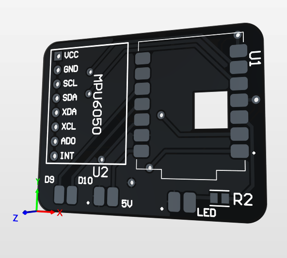
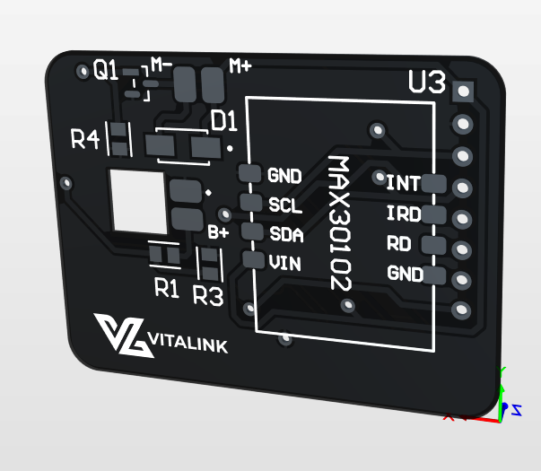
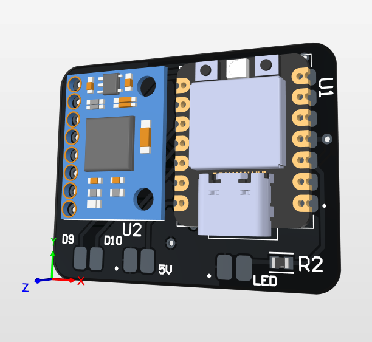
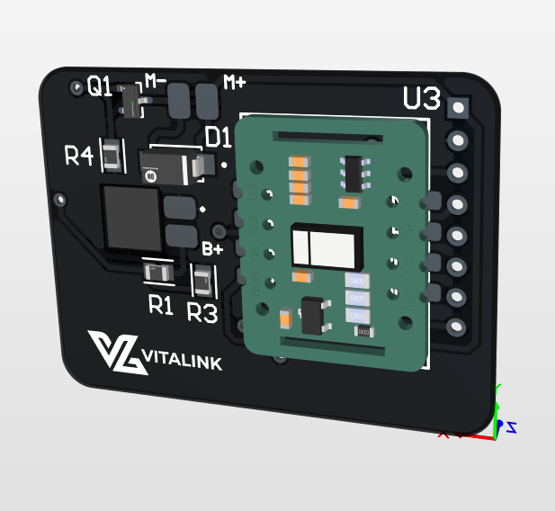
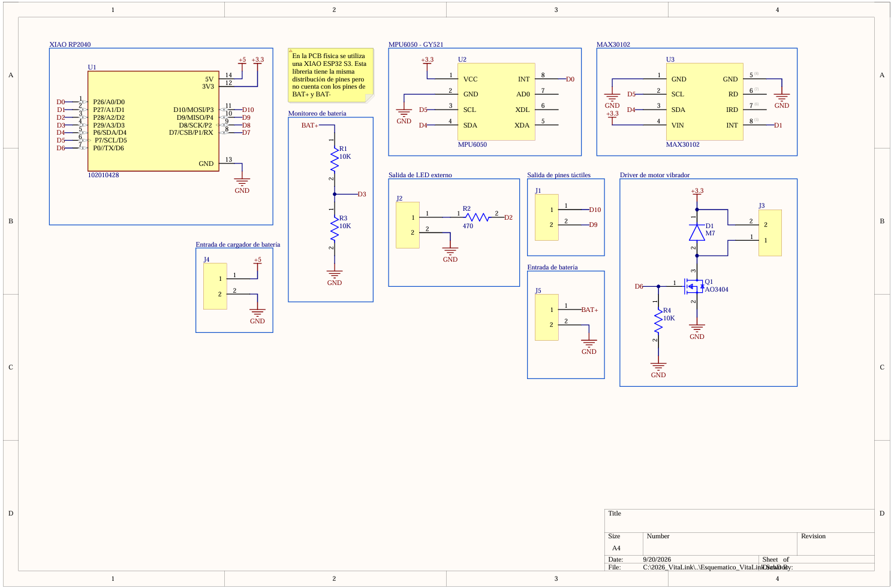

# VitaLink

**VitaLink** es una pulsera inteligente y un ecosistema de aplicaciones diseñado para cuidar a nuestros adultos mayores. Su objetivo es detectar caídas al instante y monitorear signos vitales (oxígeno en sangre y ritmo cardíaco) en tiempo real. 

A diferencia de otras opciones costosas del mercado, VitaLink se conecta por Bluetooth Low Energy (BLE) al celular del paciente, usando el teléfono como puente para comunicarse con los familiares a través de la nube. Esto permite que la pulsera sea económica, liviana y con un consumo energético optimizado al máximo.

---

## ¿Cómo funciona el sistema?

El proyecto es el resultado del trabajo en equipo dividido en tres áreas clave:

### 1. El Hardware (La Pulsera)
Diseñamos nuestra propia placa electrónica (PCB) desde cero para que sea lo más pequeña, integrada y eficiente posible.
*   **Cerebro (Microcontrolador):** Utilizamos un **Seeed Studio XIAO ESP32-S3** de bajo consumo con Bluetooth 5.0 (BLE) integrado y gestión de carga para batería LiPo.
*   **Sensores de Salud y Movimiento:** 
    *   **Sensor Inercial (`MPU6050`):** Acelerómetro configurado con filtro digital pasa-bajos (21 Hz) para detectar caídas libres e impactos, manteniendo el giroscopio en *standby* para reducir su consumo en un 87%.
    *   **Sensor Óptico (`MAX30102`):** Fotopletismógrafo que mide el ritmo cardíaco (BPM) y la saturación de oxígeno en sangre ($\text{SpO}_2$) iluminando la muñeca, con detección automática de colocación.
*   **Monitoreo de Batería LiPo:** Divisor resistivo conectado al ADC con calibración de fábrica, sobremuestreo, filtro exponencial (EMA) y curva de descarga LiPo por tramos con histéresis.

#### Nuestro Diseño Electrónico

| Vista Frontal (Top Layer) | Vista Trasera (Bottom Layer) |
| :---: | :---: |
|    *Placa base sin soldar* |    *Placa base sin soldar* |
|    *Placa con componentes* |    *Placa con componentes* |

**Esquemático del Circuito:**

*(Diagrama general de las conexiones electrónicas)*

---

### 2. El Firmware
Desarrollado en **C/C++** sobre **PlatformIO** utilizando el sistema operativo en tiempo real **FreeRTOS**:
*   **Arquitectura Multitarea en 2 Núcleos:**
    *   **Core 0:** Dedicado a la gestión del servidor Bluetooth BLE, envío de telemetría de batería y recepción de actualizaciones inalámbricas (OTA).
    *   **Core 1:** Dedicado al procesamiento biométrico del `MAX30102` y al algoritmo de vigilancia de caídas del `MPU6050`, protegiendo el bus compartido $\text{I}^2\text{C}$ mediante un semáforo **Mutex** (`i2cMutex`).
*   **Ahorro Inteligente de Energía:**
    *   Frecuencia del procesador reducida a `80 MHz` y potencia de transmisión BLE ajustada a `0 dBm`.
    *   Cuando la pulsera no está conectada por Bluetooth o no está colocada en la muñeca, tanto el `MAX30102` como el `MPU6050` entran en modo de bajo consumo.
    *   Detección de presencia en muñeca mediante un destello infrarrojo cada 1 segundo y ciclos automáticos de medición (30 segundos activos cada 2 minutos de descanso).
*   **Detección de Caídas en 2 Fases con Ventana Temporal:** Evalúa primero la fase de ingravidez ($< 0.6\text{g}$) y exige que el impacto ($> 4.0\text{g}$) ocurra dentro de una ventana física real (`250 ms` a `700 ms`), descartando movimientos bruscos de la mano o sacudidas cortas.
*   **Actualización Inalámbrica (OTA por BLE):** La pulsera puede actualizar su propio firmware directamente desde la app móvil por Bluetooth, integrando un script automatizado (`publicar_ota.py`) que publica cada nueva compilación en **GitHub Releases** y **Firebase Firestore**.

---

### 3. El Software (La App Móvil)
Desarrollamos una aplicación multiplataforma en **React Native (Expo)** conectada en tiempo real con **Firebase Authentication** y **Cloud Firestore**:
*   **Modo Paciente:** Interfaz clara e intuitiva con números grandes y pantalla inmersiva. Se conecta y reconecta automáticamente por Bluetooth a la pulsera VitaLink, muestra signos vitales y batería en vivo, permite actualizar el firmware de la pulsera por OTA y, ante una caída o alerta SOS, abre una cuenta regresiva de seguridad antes de enviar la alerta con ubicación **GPS** a la nube.
*   **Modo Familiar / Cuidador:** Panel de control remoto vinculado mediante un código único de invitación. Permite supervisar el pulso, oxígeno en sangre y nivel de batería del adulto mayor en tiempo real, recibir alertas inmediatas ante caídas o emergencias SOS con la ubicación exacta en el mapa, y consultar un **Asistente de Salud con Inteligencia Artificial** contextualizado con las mediciones del paciente.
